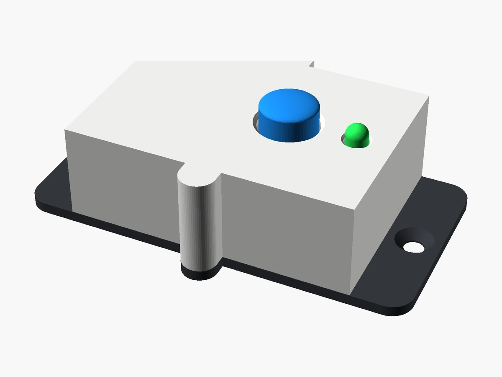
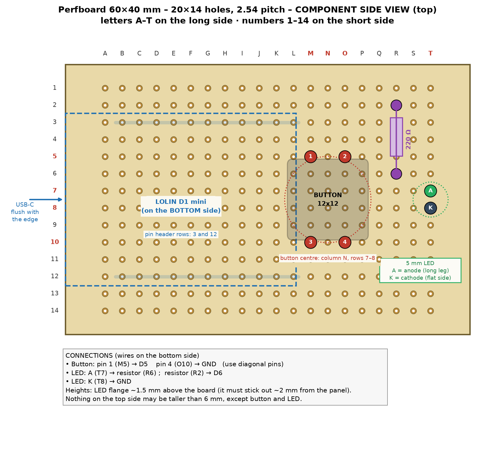
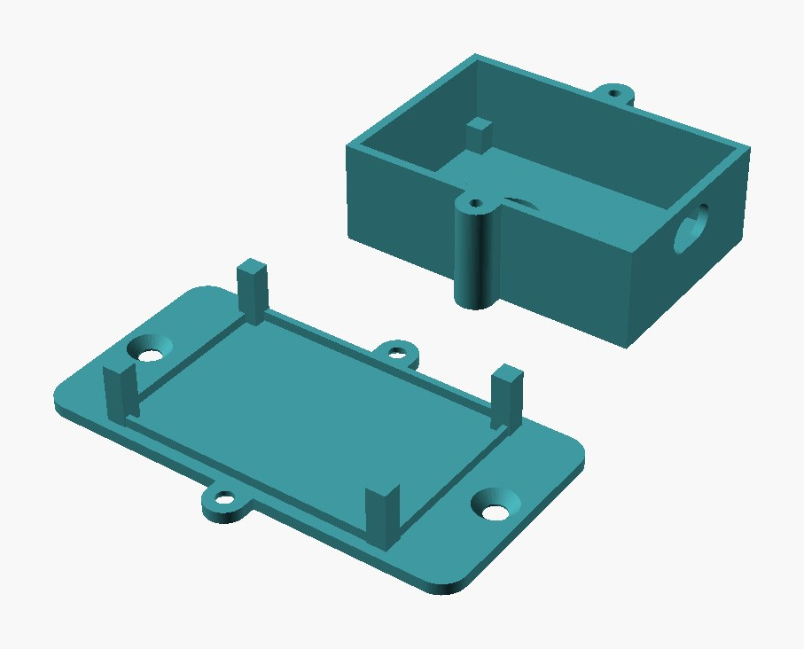
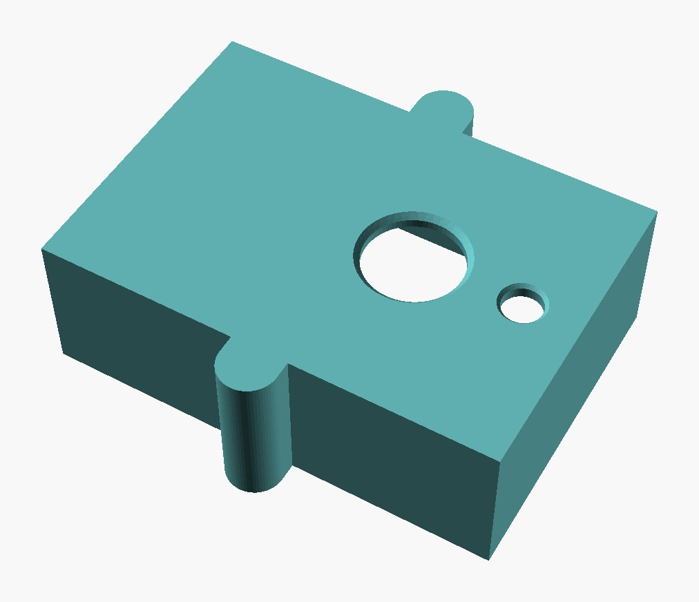

# Physical button for Home Assistant with ESP8266, ESPHome, status LED and 3D-printed case

> 📖 **Full article with wiring diagram, photos and step-by-step explanations (in Italian):**  
> **[Physical button for Home Assistant with ESP8266, ESPHome, status LED and 3D-printed case – www.emgi.it](https://www.emgi.it/2026/10/03/pulsante-fisico-home-assistant-esp8266-esphome-led-case-3d/)**
>
> More electronics, Arduino, ESP32, Home Assistant and 3D printing projects at **[www.emgi.it](https://www.emgi.it)**

This project integrates with Home Assistant. If you have not installed it yet, start from the guide [How to install Home Assistant on Raspberry Pi 4, 5 and Zero](https://www.emgi.it/2026/04/14/installare-home-assistant-su-raspberry-pi/) (in Italian).

Sometimes grabbing the phone or opening the dashboard just to switch one thing on is a nuisance. I wanted a **physical button**, mounted under the desk, that toggles a Home Assistant smart plug with one click and uses an **LED** to show right away whether the device is on or off.

## What it does

- one click **toggles** any Home Assistant `switch` entity (smart plug, relay, Shelly, Sonoff…)
- the **LED** follows the real state of the device, even when you control it from the app or an automation
- the LED **blinks** when the Wi-Fi is missing (fast) or Home Assistant is not connected (slow)
- adjustable **LED brightness** and a button that can be disabled from Home Assistant
- built-in **web interface**, with firmware updates from the browser too
- fallback Wi-Fi network with a **captive portal** if the home network cannot be reached

## What you need

| Component | Notes |
|---|---|
| Wemos / LOLIN D1 mini (ESP8266) | The v4.0.0 with USB-C works too |
| 12×12 mm tactile button with round cap | Cap Ø 12.8 mm |
| 5 mm LED | Any colour you like |
| 220 Ω resistor | 220–330 Ω for the LED |
| 4×6 cm perfboard | 20×14 holes, 2.54 mm pitch |
| Male/female pin headers | To mount the D1 mini under the perfboard |
| 2 countersunk M3×12 screws + 2 Ø 4 mm wood screws | To close the case and fix it under the desk |
| 3D-printed case | STL files in [`case_3d`](case_3d) |

## Wiring

Board: **Wemos D1 mini** (ESP8266). Pins checked against the YAML (`GPIO14` button, `GPIO12` LED).

| Wemos D1 mini | Connected to |
|---|---|
| **D5 / GPIO14** | one pin of the 12×12 button |
| **GND** | the button pin **diagonally opposite** |
| **D6 / GPIO12** | **220 Ω** resistor → LED anode (long leg) |
| **GND** | LED cathode (flat side) |

- Use two **diagonally opposite** pins of the button: on 12×12 buttons the pins are connected in pairs, and the diagonal pair is always the switched contact.
- No pull-up resistor: the ESP8266's internal one is used.
- On some D1 mini boards the silkscreen shows 12 and 14 instead of D6 and D5: it is the same physical pin.

### Layout on the 4×6 cm perfboard

Grid: letters A–T along the long side starting from the USB side, numbers 1–14 along the short side.

- **Button**: holes M5, O5, M10, O10 (centred on column N)
- **LED**: anode in T7, cathode in T8 (flange about 1.5 mm above the board)
- **Resistor**: from R2 to R6, lying flat
- **D1 mini**: under the perfboard, pin headers in rows 3 and 12, USB flush with the short edge
- The connections are made with thin wire on the underside.

## Repository contents

| Path | Description |
|---|---|
| `esphome/ha-button.yaml` | ESPHome configuration |
| `esphome/secrets.yaml.example` | Example secrets.yaml (copy it and fill in your data) |
| `case_3d/ha_button_shell.stl` | 3D model to print (shell) |
| `case_3d/ha_button_base.stl` | 3D model to print (base) |
| `images/` | Photos and images |

## How to use it

1. Copy [`esphome/ha-button.yaml`](esphome/ha-button.yaml) into ESPHome.
2. Change the `target:` line to the `entity_id` of the device you want to control.
3. Add the entries from [`secrets.yaml.example`](esphome/secrets.yaml.example) to your ESPHome `secrets.yaml`, with your own data.
4. Print the shell and the base from the [`case_3d`](case_3d) folder.

Wiring diagram, details and troubleshooting: **[article on www.emgi.it](https://www.emgi.it/2026/10/03/pulsante-fisico-home-assistant-esp8266-esphome-led-case-3d/)** (in Italian).

## Images

## License

- Code and configuration: [MIT](LICENSE)
- 3D models, diagrams and images: [CC BY-SA 4.0](https://creativecommons.org/licenses/by-sa/4.0/)

---

**Author:** Massimiliano Sandrin – **[eMGi.it](https://www.emgi.it)** · Questions and comments below the [article on the website](https://www.emgi.it/2026/10/03/pulsante-fisico-home-assistant-esp8266-esphome-led-case-3d/).
