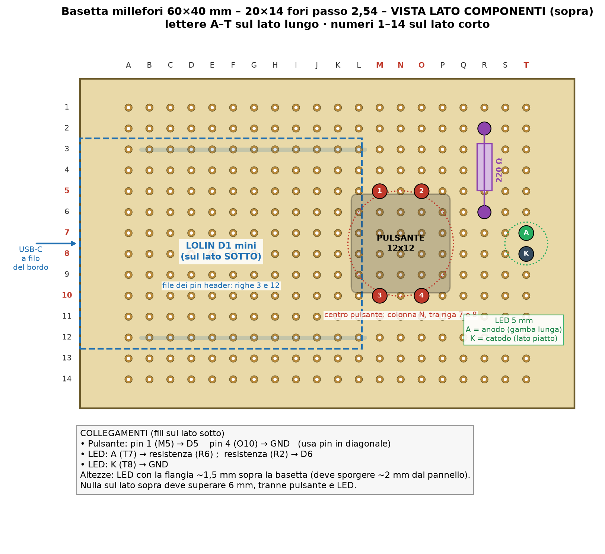

# Pulsante fisico per Home Assistant con ESP8266, ESPHome, LED di stato e case stampato in 3D

> 📖 **Articolo completo con schema, foto e spiegazioni passo passo:**  
> **[Pulsante fisico per Home Assistant con ESP8266, ESPHome, LED di stato e case stampato in 3D – www.emgi.it](https://www.emgi.it/2026/10/03/pulsante-fisico-home-assistant-esp8266-esphome-led-case-3d/)**
>
> Altri progetti di elettronica, Arduino, ESP32, Home Assistant e stampa 3D su **[www.emgi.it](https://www.emgi.it)**

Questo progetto si integra in Home Assistant. Se non l’hai ancora installato, parti dalla guida [Come installare Home Assistant su Raspberry Pi 4, 5 e Zero](https://www.emgi.it/2026/04/14/installare-home-assistant-su-raspberry-pi/).

A volte toccare lo smartphone o aprire la dashboard per accendere una cosa sola è una scomodità. Volevo un **pulsante fisico**, montato sotto la scrivania, che con un clic accendesse e spegnesse una presa smart di Home Assistant, e che con un **LED** mi dicesse subito se il dispositivo è acceso o spento.

## Cosa fa il progetto

- un clic sul pulsante **accende/spegne** qualsiasi entità `switch` di Home Assistant (presa smart, relè, Shelly, Sonoff…)
- il **LED** segue lo stato reale del dispositivo, anche se lo comandi da app o da automazione
- il LED **lampeggia** se manca il Wi-Fi (veloce) o se Home Assistant non è collegato (lento)
- **luminosità del LED** regolabile e pulsante disattivabile da Home Assistant
- **interfaccia web** integrata, con aggiornamento firmware anche dal browser
- rete Wi-Fi di emergenza con **captive portal** se la rete di casa non è raggiungibile

## Cosa serve

| Componente | Note |
|---|---|
| Wemos / LOLIN D1 mini (ESP8266) | Va bene anche la v4.0.0 con USB-C |
| Pulsante tattile 12×12 mm con cappuccio tondo | Cappuccio Ø 12,8 mm |
| LED 5 mm | Del colore che preferisci |
| Resistenza 220 Ω | 220–330 Ω per il LED |
| Basetta millefori 4×6 cm | 20×14 fori, passo 2,54 mm |
| Pin header maschio/femmina | Per montare il D1 mini sotto la basetta |
| 2 viti M3×12 svasate + 2 viti da legno Ø 4 mm | Chiusura del case e fissaggio sotto il piano |
| Case stampato in 3D | File STL scaricabile in fondo all’articolo |

## Collegamenti elettrici

Scheda: **Wemos D1 mini** (ESP8266). Pin verificati sul YAML (`GPIO14` pulsante, `GPIO12` LED).

| Wemos D1 mini | Collegato a |
|---|---|
| **D5 / GPIO14** | un pin del pulsante 12×12 |
| **GND** | il pin del pulsante **in diagonale** |
| **D6 / GPIO12** | resistenza **220 Ω** → anodo del LED (gamba lunga) |
| **GND** | catodo del LED (lato piatto) |

- Usa due pin **in diagonale** del pulsante: nei pulsanti 12×12 i pin sono collegati a coppie e in diagonale il contatto è sempre quello giusto.
- Nessuna resistenza di pull-up: si usa quella interna dell'ESP8266.
- Su alcuni D1 mini la serigrafia riporta 12 e 14 invece di D6 e D5: il pin fisico è lo stesso.

### Disposizione sulla millefori 4×6 cm

Griglia: lettere A–T sul lato lungo partendo dal lato USB, numeri 1–14 sul lato corto.

- **Pulsante**: fori M5, O5, M10, O10 (centro sulla colonna N)
- **LED**: anodo in T7, catodo in T8 (flangia a circa 1,5 mm dalla basetta)
- **Resistenza**: da R2 a R6, sdraiata
- **D1 mini**: sotto la basetta, pin header nelle righe 3 e 12, USB a filo del bordo corto
- I collegamenti si fanno con filo sottile sul lato sotto.

## Contenuto del repository

| Percorso | Descrizione |
|---|---|
| `esphome/pulsante-ha.yaml` | Configurazione YAML |
| `esphome/secrets.yaml.example` | Esempio di secrets.yaml (da copiare con i tuoi dati) |
| `case_3d/scocca_pulsante_ha.stl` | Modello 3D da stampare |
| `case_3d/fondo_pulsante_ha.stl` | Modello 3D da stampare |
| `immagini/` | Foto e immagini dell'articolo |

## Come si usa

1. Copia [`esphome/pulsante-ha.yaml`](esphome/pulsante-ha.yaml) in ESPHome.
2. Cambia la riga `target:` con l'`entity_id` del dispositivo da comandare.
3. Aggiungi al `secrets.yaml` di ESPHome le voci di [`secrets.yaml.example`](esphome/secrets.yaml.example) con i tuoi dati.
4. Stampa scocca e fondo dalla cartella [`case_3d`](case_3d).

Schema dei collegamenti, dettagli e risoluzione dei problemi: **[articolo su www.emgi.it](https://www.emgi.it/2026/10/03/pulsante-fisico-home-assistant-esp8266-esphome-led-case-3d/)**.

## Immagini

## Licenza

- Codice e configurazioni: [MIT](LICENSE)
- Modelli 3D, schemi e immagini: [CC BY-SA 4.0](https://creativecommons.org/licenses/by-sa/4.0/deed.it)

---

**Autore:** Massimiliano Sandrin – **[eMGi.it](https://www.emgi.it)** · Domande e commenti sotto l'[articolo sul sito](https://www.emgi.it/2026/10/03/pulsante-fisico-home-assistant-esp8266-esphome-led-case-3d/).
